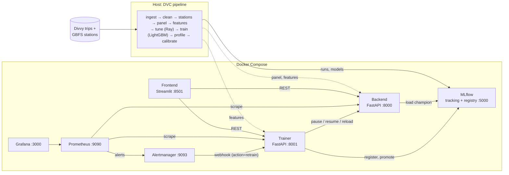

# Architecture

The system has two parts:

- **Offline pipeline (host):** a DVC pipeline that builds the data and the first model with Spark, Ray Tune and LightGBM.
- **Online system (Docker Compose):** seven services that serve forecasts, monitor the model on replayed traffic and retrain it when its error stays high.

Everything runs on one laptop. No cloud services are used.

Solid arrows are API calls. Dotted arrows are files mounted read-only.

## Blocks

| Block | What it does |
|---|---|
| DVC pipeline | Nine stages. Spark cleans 8.87M trips and builds the 18.4M-row station-hour panel and 14.1M feature rows. Ray Tune searches LightGBM settings, `train` fits the final model. `profile` and `calibrate` prepare monitoring. Only changed stages rerun. |
| MLflow | Stores every run with its metrics, artifacts, git commit and DVC data hash. The registry holds `bikeshare-demand`; the `champion` alias marks the version in use. |
| Backend | Loads the champion and reloads it within 30 s of the alias moving. Computes features online with the same function as the pipeline, forecasts every station and ranks alerts. Also runs the replay monitor, which plays March–September 2026 as live traffic and scores each simulated day. |
| Frontend | Four pages: rebalancing alerts, station forecast, model monitoring, pipeline console. Talks to the backend and trainer only through REST, at URLs set by `BACKEND_URL` and `TRAINER_URL`. |
| Trainer | Receives retraining alerts, pauses the replay, trains a challenger, runs the promotion gate and moves `champion` if it passes. Also does rollback. Kept apart from the backend so a 5 GB training job cannot affect the API. |
| Prometheus | Scrapes the backend, trainer and Alertmanager every 5 s. Five alert rules: forecast error (`action=retrain`), drift (`action=investigate`), backend down, 5xx errors, slow requests. |
| Alertmanager | Sends `action=retrain` alerts to the trainer. Everything else stays on the dashboards. |
| Grafana | One dashboard: replay clock, error and drift, firing alerts, retraining history, API traffic and latency. Read-only without a login. |

## Main flows

1. **Forecast:** the user picks an hour, the frontend calls `/alerts`, the backend computes that day's features (or uses the cache), runs the model and ranks stations.
2. **Monitoring:** the replay forecasts every hour, scores each simulated day and publishes 7-day error and drift. Prometheus checks the alert rules.
3. **Retraining:** the error alert fires, then Alertmanager → trainer → pause replay → train → gate → register → promote or reject → backend reloads → replay resumes.
4. **Rollback:** the user presses *Roll back the champion*. The trainer moves `champion` back and the backend reloads it.
