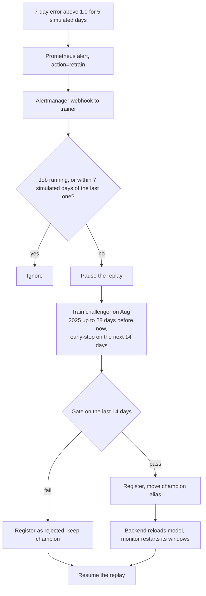

# High-level design

We forecast hourly pickups and drop-offs for every Divvy station in Chicago, 1 to 3 hours ahead, and list the stations most likely to run out of bikes or docks. Trip data from March to September 2026 is replayed as if it were live. The codes in brackets (D1, T4, R7 and so on) are decision numbers; comments in the code refer to them.

## User workflow

1. A dispatcher opens the frontend and picks a date and hour between March and September 2026.
2. The frontend calls the backend over REST. It does not know anything about the model or its features.
3. The backend computes that day's features from the station-hour panel, runs the champion model on busy classic stations and a historical average on the rest, and ranks stations by forecast 3-hour net flow as a share of docks.
4. The dispatcher sees two lists, *likely draining* (send bikes) and *likely filling* (free up docks), and a map. A person decides where the trucks go.
5. On the monitoring page, an operator replays months of traffic. If the model stays worse than the historical average for 5 simulated days, it is retrained automatically. The pipeline console shows each retraining result and has a rollback button.

## Design decisions

| Decision | Reason and trade-off |
|---|---|
| Forecast flows and rank by *demand pressure* (net flow / docks) (D1) | Divvy publishes no history of bikes docked at a station, so we cannot predict when one is empty. Pressure is honest, but the user still has to judge how full a station is. |
| Model only classic stations with 5+ trips/day; historical average for the rest (D2) | 79% of station-hours have zero trips. Modelling sparse stations adds noise. Quiet stations still get a forecast, marked low confidence, and never raise alerts. |
| Two global LightGBM models (pickups, drop-offs), Poisson objective, horizon as an input (D3) | Two models are easier to tune and explain than one per horizon. Poisson suits counts that are mostly zero. Horizons stop at 3 h, which gives dispatchers less lead time. |
| Chronological split: train Aug–Dec 2025, validate Jan, test Feb, replay Mar–Sep 2026 (D4) | No leakage, and the replay months act as production. The test month is quiet, so margins over the baselines are small (1–3% WAPE). |
| Spark for cleaning, the panel and features | 8.87M trips and 14.1M feature rows. Spark runs in local mode with capped memory after two out-of-memory crashes on the 14 GB laptop. |
| One feature function shared offline (Spark `applyInPandas`) and online (D6) | Training and serving cannot drift apart. A test checks the two give identical inputs. Online, a new day takes 15–35 s to compute. |
| Ray Tune, 12 trials per target, ranked by Poisson deviance | All 24 trials landed within 0.5% of each other, so tuning is not the bottleneck. Retraining reuses the result. |
| WAPE as the main metric | Most hours have zero trips, so percentage errors are undefined. WAPE is total error over total trips. |
| Model served inside FastAPI from the MLflow registry `champion` alias (D7) | One fewer service and no restart when the model changes. It does not use `mlflow models serve`; the logged pyfunc would work with it unchanged. |
| Streamlit frontend in its own container (D8) | Fast to build. Loose coupling: REST only, URLs set by environment variables. |
| Replay monitor inside the backend (T1) | It forecasts through the same code path dispatchers use. Error is model WAPE divided by fallback WAPE, because raw WAPE falls as summer demand rises even with the same model. |
| Thresholds calibrated offline: error > 1.0 or drift (PSI) > 0.5 for 5 simulated days (T4) | They fire once in the replay, in early March, the real weak spot. A 3-day sustain gave two false alarms in February. |
| Only sustained error retrains; drift is a warning (owner decision, M5) | In Jan–Feb drift was high while the model beat its fallback by 5–30%. Drift alone would retrain a working model. |
| Separate trainer container (R1) | Training peaks near 5 GB against the backend's 3 GB limit. A failed job cannot take the API down, and the API keeps serving during retraining. |
| Promotion gate on the last 14 days, which neither model trained on (D9, owner amendments) | The challenger must beat the champion overall, stay within 3% on every horizon and station tier, and beat each baseline the champion beats. A worse model is never kept in place. In practice the gate becomes "beat the champion and stay within 3%". |
| Rollback by hand (R7) | An automatic rollback would need its own trigger rules. The previous version is recorded on each promoted model. |
| DVC for data, Git for code, MLflow for models | Every model traces to a git commit, a DVC data hash and an MLflow run. A rerun of tuning and training reproduced the same model file byte for byte. |

## Quality and failure behaviour

- Invalid forecast times return 422, unknown stations 404, a missing model 503. The frontend shows the error and never shows a made-up forecast.
- If the registry is unreachable, the backend keeps serving the model it has.
- A retraining job runs in a subprocess. If it crashes or runs out of memory, the replay is still resumed and the failure is recorded.
- Promotion is refused if the champion changed while the job was running.
- Code is a functional core (features, metrics, PSI, gate) with small classes for state (model store, feature store, replay monitor, trainer). Logging uses Python `logging`. ruff 0.17's default rules pass on all code.
- All ports bind to localhost. The only secret, the Grafana admin password, is in a git-ignored `.env`. There is no encryption or user login; this is a local course project, not a production portal.

## Performance and capacity

| What | Measured |
|---|---|
| `clean` / `panel` / `features` stages | 50 s / 37 s / 62 s |
| Tuning / final training | under 45 min / about 18 min, peak 4.9 GB |
| Forecast for a new day / a cached hour | 15–35 s / 0.08 s |
| Replay | about 45 s per simulated day in Docker |
| Retraining job | 12.5 min, peak about 5 GB, in a 6 GB container |
| Test month WAPE, model / historical average / last week | pickups 0.817 / 0.842 / 0.991, drop-offs 0.819 / 0.826 / 0.963 |

These are single runs on one laptop, not load tests.

## Retraining sequence

In the end-to-end run, the alert at simulated 11 March retrained version 3. It beat version 1 on both targets (pickups WAPE 0.8379 vs 0.8420, drop-offs 0.8337 vs 0.8387) and was promoted. A rollback restored version 1.

Known limits:
- For stations with 5–10 trips/day the model only ties the historical average, and on drop-offs it is slightly worse (test-month WAPE 0.997 against 0.984). This is why the gate allows 3%.
- The replay pauses for about 12 minutes while a model trains. This is not a zero-downtime retraining.
- The cooldown lives in the trainer's memory, so restart the trainer before replaying the same dates again.
- There is no CI server (D11). The DVC pipeline, tests and smoke test are run by hand.
- The weather experiment (D5) was never run.
