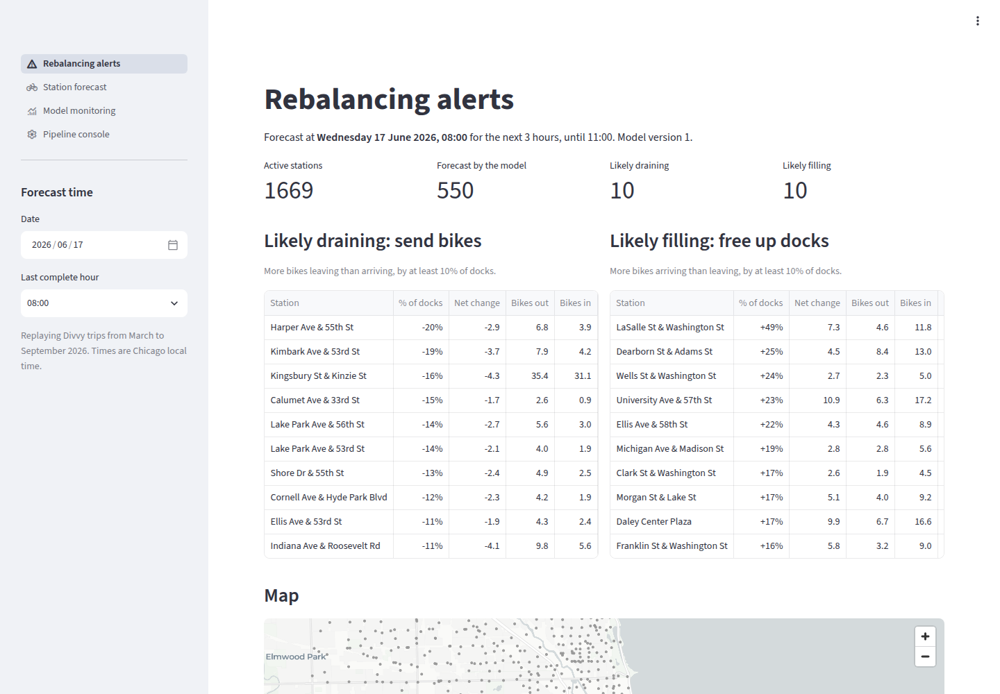
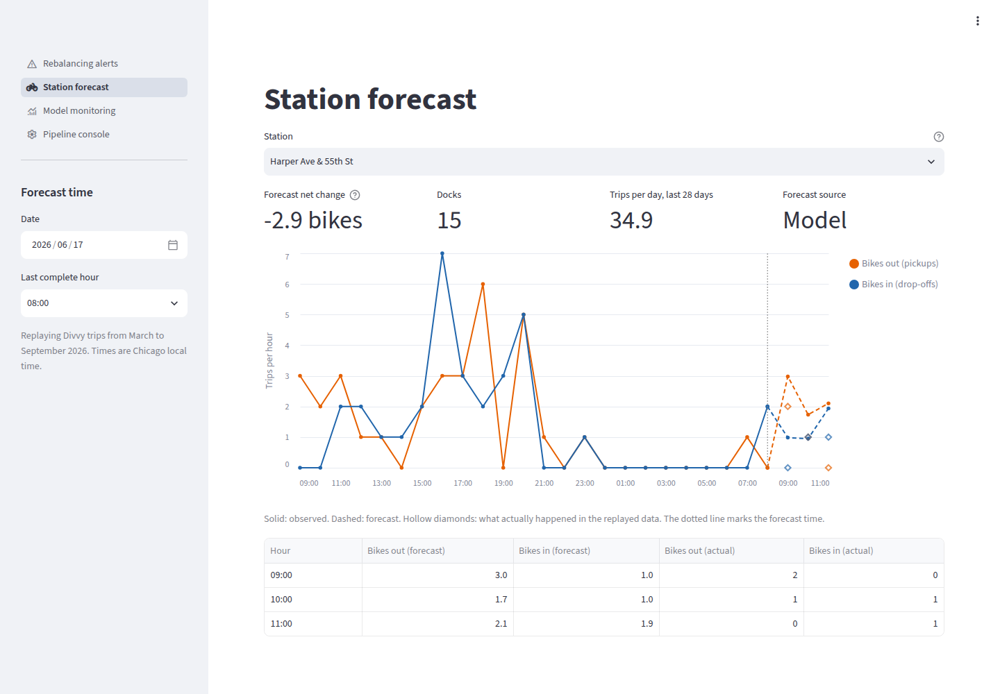
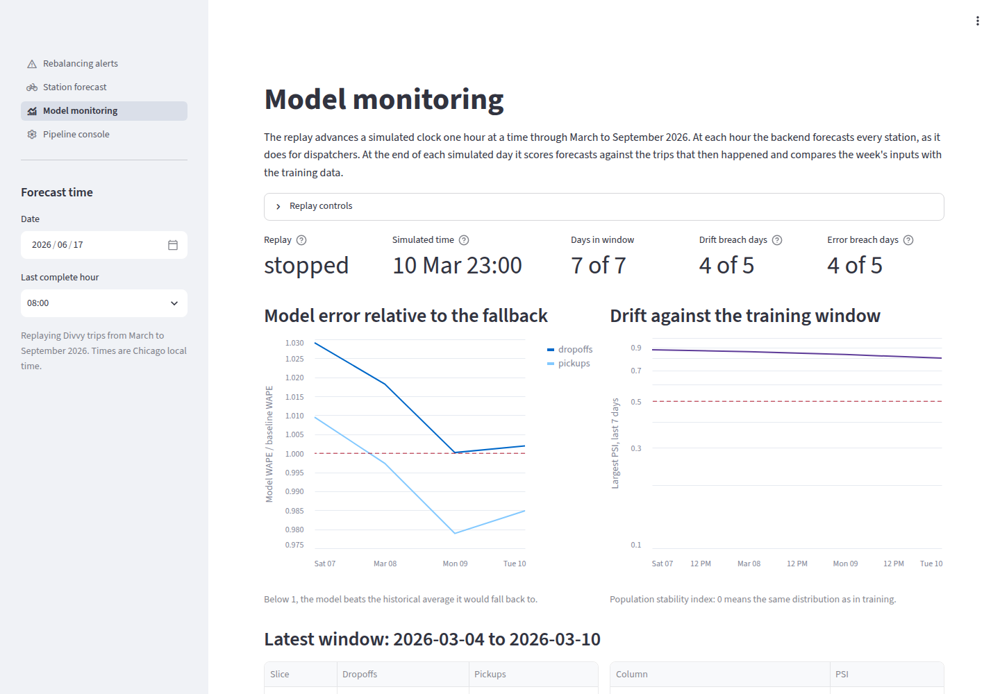
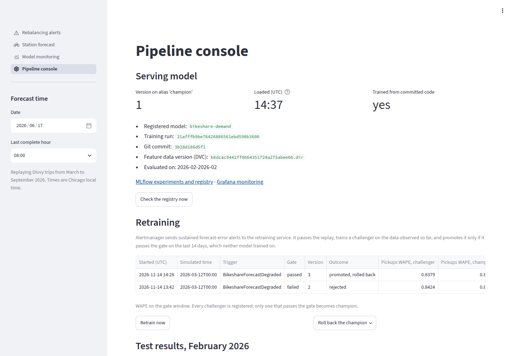

# User manual

This guide is for dispatchers and operations staff. It explains how to use the bike-share rebalancing app to decide where to send rebalancing trucks. No technical knowledge is needed. Setup is covered at the end, for whoever installs the app.

## 1. What the app does

Bike-share stations run out of bikes, or out of free docks, when riders take bikes away faster than they bring them back, or the other way round. The app forecasts, for every Divvy station in Chicago, how many bikes will be taken and returned over the next 3 hours. It then lists the stations most likely to:

- **drain:** more bikes leaving than arriving, so riders may find no bike. *Send bikes there.*
- **fill:** more bikes arriving than leaving, so riders may find no free dock. *Take bikes away.*

The app works on past data replayed as if it were happening now. You choose a date and hour between March and September 2026, and it forecasts the 3 hours that follow, using only data up to that hour.

## 2. Opening the app

Open **http://localhost:8501** in a web browser (Chrome, Firefox, Edge or Safari) on the computer where the app runs. The menu on the left has four pages:

| Page | Use it to |
|---|---|
| **Rebalancing alerts** | See which stations need attention now. This is the main page. |
| **Station forecast** | Look at one station in detail |
| **Model monitoring** | See whether the forecasts are still accurate |
| **Pipeline console** | See which forecasting model is in use, and retrain or restore it |

## 3. Choosing the forecast time

At the top of the left-hand menu:

1. **Date:** pick a day between 1 March and 30 September 2026.
2. **Last complete hour:** pick the hour you are "standing at". For example, 17:00 means the data up to 5 pm is known, and the app forecasts 5 pm to 8 pm.

All times are Chicago local time. The first forecast for a new day takes 15 to 30 seconds while the app prepares that day; other hours of the same day appear within a second.

## 4. Rebalancing alerts



The line under the title repeats the forecast time and the 3-hour period it covers. The four numbers below it show:

- **Active stations:** stations open at that time.
- **Forecast by the model:** busier stations that get a full forecast. The others get a simpler estimate (see *Low confidence* in section 9).
- **Likely draining** and **Likely filling:** how many stations are listed in each table.

### The two tables

| Column | Meaning |
|---|---|
| **Station** | Station name |
| **% of docks** | Forecast net change as a share of the station's docks. −60% means bikes equal to 60% of its docks are expected to leave beyond what arrives. Larger numbers matter more. |
| **Net change** | Bikes expected to arrive minus bikes expected to leave over the 3 hours |
| **Bikes out** | Bikes expected to be taken |
| **Bikes in** | Bikes expected to be returned |
| **Docks** | Total docks at the station |

Stations are sorted with the most urgent at the top. A station is listed only if its net change is at least 10% of its docks. Each list shows at most 10 stations.

**What to do:** send bikes to the stations at the top of *Likely draining*, and collect bikes from the top of *Likely filling*. Pairing a filling station with a nearby draining one makes one truck trip do both jobs.

### The map

Orange dots are likely draining, blue dots likely filling, and small grey dots have no alert. Hover over a dot to see its name and forecast net change. Scroll to zoom and drag to move.

### What the app cannot tell you

The app does not know how many bikes are at a station right now. Divvy does not publish that history. A station near the top of *Likely draining* will lose bikes; whether it runs empty depends on how full it was. Use the list together with what your team sees on the street. *How to read these alerts*, at the bottom of the page, repeats these points.

## 5. Station forecast



1. Choose a station from the **Station** list. Stations with alerts come first, then all others alphabetically. Type to search.
2. The four numbers show the forecast net change, the station's docks, its average trips per day over the last 4 weeks, and whether the forecast comes from the model or the simpler historical average.
3. The chart shows:
   - **solid lines:** bikes taken (orange) and returned (blue) in the last 24 hours;
   - **dashed lines:** the forecast for the next 3 hours;
   - **hollow diamonds:** what actually happened in those hours. This is possible because the app replays past data; use it to judge how well the forecast did.

   The dotted vertical line marks the forecast time.

## 6. Model monitoring



This page checks whether the forecasts are still good. It plays the months from March to September as if they were happening live, one simulated hour at a time, and after each simulated day it compares the forecasts with what really happened.

### Running a replay

1. Open **Replay controls**.
2. Choose a **Start** and **End** date, and a **Pace**. "As fast as possible" takes about 45 seconds per simulated day.
3. Press **Start replay**. Press **Stop replay** at any time. Starting again clears the results.

### Reading the page

- **Replay** shows *running*, *paused* or *stopped*. *Paused* means the model is being retrained (section 7); the replay continues by itself afterwards.
- **Simulated time** is the hour the replay has reached.
- **Days in window:** results cover the last 7 simulated days. Charts appear once 7 days have been played.
- **Drift breach days** and **Error breach days** count how many days in a row each warning sign has been above its limit. At 5 days, an alert is raised.
- **Model error relative to the fallback** (left chart): below 1, the model is better than the simple historical average; above the dashed red line (1.0), it is worse.
- **Drift against the training window** (right chart): how different recent conditions are from those the model learned from. Above the dashed line for 5 days raises a *drift* warning. It does not retrain the model by itself, because the model often stays accurate when conditions shift.

If the error stays above its line for 5 simulated days, the app retrains the model automatically. The **Pipeline console** shows the outcome.

## 7. Pipeline console



### Serving model

Shows which model version is producing forecasts, when it was loaded, and where it came from. **Check the registry now** makes the app pick up a newly approved model at once instead of within 30 seconds.

### Retraining

When forecasts have been worse than the historical average for 5 simulated days, the app:

1. pauses the replay;
2. trains a new model on all the data seen so far (about 5 to 10 minutes);
3. compares it with the current model on the last 2 weeks of data, which neither model learned from;
4. switches to the new model only if it is better overall and not more than 3% worse for any group of stations or any forecast hour;
5. resumes the replay.

The table lists every retraining attempt:
- **Simulated time:** when it happened in the replay.
- **Gate:** passed or failed.
- **Outcome:** *promoted* means the new model was put into use; *rejected* means the current one was kept; *promoted, rolled back* means it was used and then replaced by the previous model.
- The error of both models. Lower is better.

When a new model is rejected, a yellow box explains why.

- **Retrain now** starts a retraining at the replay's current time without waiting for an alert.
- **Roll back the champion** returns to the previous model. Open it and press **Confirm rollback**. Use this if a newly promoted model behaves badly. A green message confirms the switch, and forecasts use the restored model straight away.

### Test results and Data pipeline

The first model's results on February 2026, compared with two simple methods, and counts from each data-preparation step (for example how many trip records were rejected as invalid).

## 8. Grafana dashboard (optional)

**http://localhost:3000** opens a live dashboard with the same monitoring signals, alerts and retraining history, plus how busy and how fast the app is. It is read-only and needs no login. The Model monitoring and Pipeline console pages link to it.

## 9. Troubleshooting and common questions

| You see | What it means and what to do |
|---|---|
| A spinner for 15–30 seconds | The app is preparing a new day. Wait; later hours of that day are fast. |
| *Cannot reach the backend* | The forecasting service is not running. Ask whoever runs the app to start it (section 10). |
| *Cannot reach the retraining service* on the Pipeline console | Retraining is unavailable, but forecasts still work. Ask whoever runs the app. |
| *Low confidence* on a station | The station is quiet (under 5 trips a day) or not a standard dock. It gets a simple historical average and never appears in the alert lists. |
| *No station is forecast to drain this much* | Nothing is urgent in that direction at that time. Night hours are often quiet. |
| *Data ends at …, so the forecast time is …* | The chosen hour is past the last data available; the app uses the latest hour it can. |
| The replay shows *paused* | A model is being retrained. It resumes by itself in about 5 to 10 minutes. |
| *There is nothing to roll back to* | The model in use was not created by retraining, so there is no earlier one to return to. |

## 10. Setup (for whoever installs the app)

You need Docker with Compose and about 9 GB of free memory.

```bash
cp .env.example .env                 # then choose a Grafana admin password in .env
docker compose up -d --build         # starts all seven services
python3 scripts/smoke_test.py        # should end with "All checks passed"
```

Stop the app with `docker compose down`. Models and retraining records are kept; a replay in progress is not, so start it again after a restart. Further detail is in the [README](../README.md).

## Glossary

| Term | Meaning |
|---|---|
| Draining / filling | More bikes leaving than arriving / more arriving than leaving |
| Net change | Bikes returned minus bikes taken over the forecast period |
| Forecast time | The last hour whose data is known; forecasts cover the 3 hours after it |
| Historical average | The average number of trips at the same weekday and hour over the past 8 weeks |
| Model, champion | The forecasting model in use. Retraining creates a *challenger* that replaces the champion only if it is better. |
| Replay | Playing past months as if they were live, to test the forecasts |
| Drift | A change in conditions compared with the data the model learned from |
| Rollback | Returning to the previous model |
